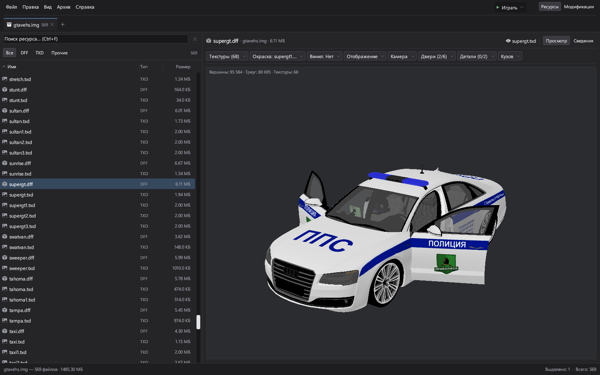
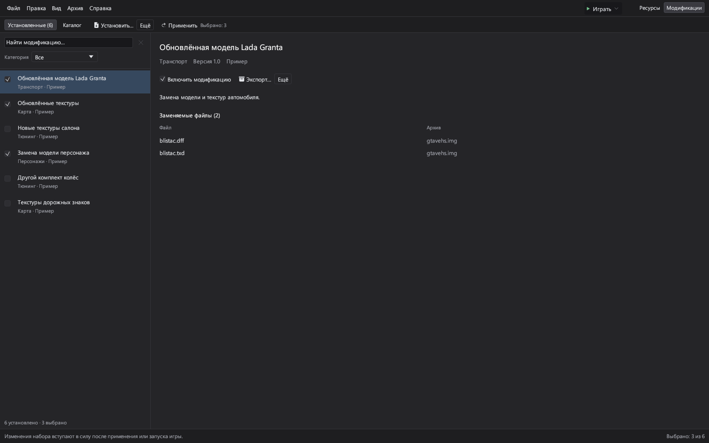
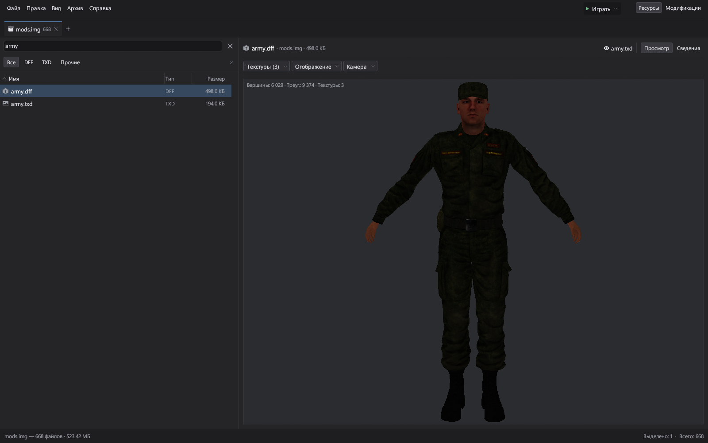
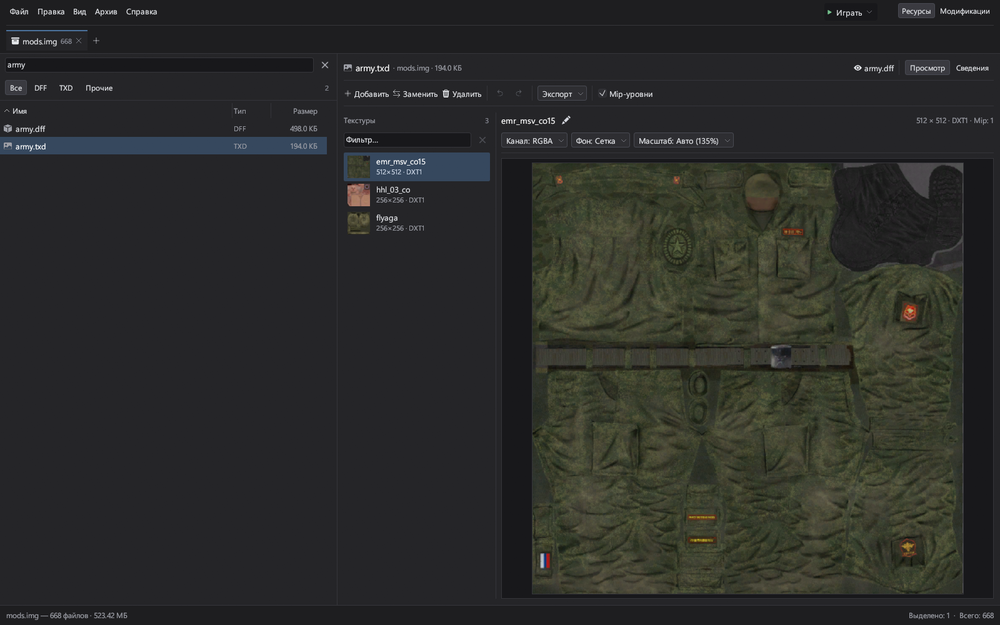

<p align="center">
  
</p>

<h1 align="center">OpenProvince</h1>

<p align="center">
  Архиватор и редактор игровых ресурсов,<br>
  созданный специально для <strong>MTA Province</strong>.
</p>

<p align="center">
  <a href="#" title="Ссылка на канал появится позже"></a>
  <a href="#" title="Ссылка на группу появится позже"></a>
  <br>
  <sub>Ссылки на канал и группу будут добавлены позже.</sub>
</p>

## Скачать

Для Windows x64. Выберите версию, скачайте файл и запустите его.

| Версия | Для чего | Скачать |
| --- | --- | --- |
| **Архиватор** | Просмотр и редактирование игровых ресурсов | [openprovince-archiver.exe](https://github.com/Vaemoon/OpenProvince/releases/latest/download/openprovince-archiver.exe) |
| **С менеджером модов** | Всё из архиватора, установка модификаций и запуск игры | [openprovince.exe](https://github.com/Vaemoon/OpenProvince/releases/latest/download/openprovince.exe) |

[Все выпуски и список изменений](https://github.com/Vaemoon/OpenProvince/releases)



*Модель с альтернативной раскраской и открытыми передними дверями.*

## Возможности

- Открытие IMG-архивов MTA Province, включая защищённые имена и ресурсы.
- Извлечение, добавление, замена и удаление файлов; сборка IMG из папки.
- Просмотр моделей DFF с текстурами, вариантами окраски и компонентами.
- Редактор TXD: просмотр, импорт и экспорт текстур, замена изображений и работа с мип-уровнями.
- Несколько открытых архивов, поиск, сортировка, просмотр FXP и анимаций IFP.

В версии с менеджером модов можно устанавливать пакеты `.opmod`, `.zip` и распакованные папки, выбирать активный набор, проверять конфликты и восстанавливать исходные файлы. Кнопка запуска переключается на остановку, когда игра работает.

Откройте IMG или TXD через меню «Файл» либо перетащите его в окно. Пакеты модификаций также поддерживают перетаскивание.

<details>
<summary><strong>Ещё скриншоты: моды, скины и текстуры</strong></summary>

### Менеджер модификаций

Демонстрационный набор пакетов без изображений: активные моды, категории, описание и заменяемые файлы.



### Просмотр скинов



Штатный скин из клиентской сборки MTA Province.

### Редактор текстур

Список текстур, отдельный предпросмотр, импорт, экспорт и мип-уровни в одном окне.



</details>

<details>
<summary><strong>Сборка из исходников</strong></summary>

Нужны Rust и инструменты сборки C++ из Visual Studio.

```powershell
git clone https://github.com/Vaemoon/OpenProvince.git
cd OpenProvince
.\build-both.cmd
```

Обе версии появятся в папке `dist`.

Проверка проекта:

```powershell
cargo test --locked --workspace
```

</details>

---

[Лицензия MIT](LICENSE). Иконки — [Bootstrap Icons](https://icons.getbootstrap.com/).
